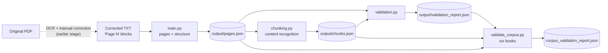
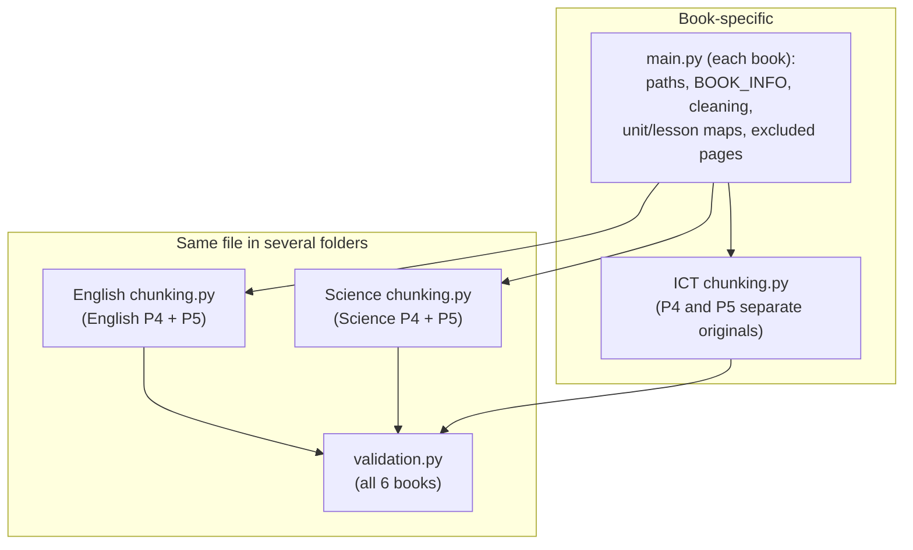
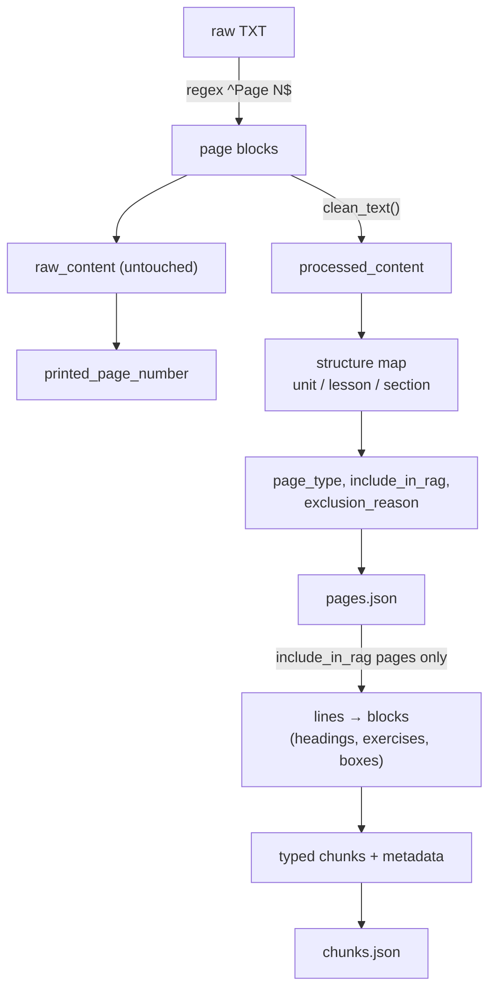

# Textbook Data Preparation Pipeline — Project Documentation

Reference documentation for the pipeline that turns six Egyptian primary-school
textbooks (Term 1) into structured, validated JSON for a future AI educational
assistant. It is written so that a new developer can run, maintain, debug and
extend the project without any other context.

Companion documents in this folder:

| File | Purpose |
|---|---|
| [ARCHITECTURE_DECISIONS.md](ARCHITECTURE_DECISIONS.md) | Why the design is the way it is (AD-01 … AD-14) |
| [FINAL_CHANGELOG.md](FINAL_CHANGELOG.md) | What was changed in each file, old vs new behaviour |
| [TEST_REPORT.md](TEST_REPORT.md) | Executed tests, statistics, manual PDF checks, open issues |
| `README.md` | Original ICT-only README (kept for history) |

---

## Contents

A. [Project overview](#a-project-overview) ·
B. [System architecture](#b-system-architecture) ·
C. [Folder and file structure](#c-folder-and-file-structure) ·
D. [The six textbook implementations](#d-the-six-textbook-implementations) ·
E. [Data processing pipeline](#e-data-processing-pipeline) ·
F. [Data schemas](#f-data-schemas) ·
G. [Chunking strategy](#g-chunking-strategy) ·
H. [Validation system](#h-validation-system) ·
I. [Running the project](#i-running-the-project) ·
J. [Testing and quality assurance](#j-testing-and-quality-assurance) ·
K. [Architecture decisions and rationale](#k-architecture-decisions-and-rationale) ·
L. [Known limitations and future improvements](#l-known-limitations-and-future-improvements) ·
M. [Future integration](#m-future-integration) ·
N. [Maintenance guide](#n-maintenance-guide)

---

## A. Project overview

### Purpose

Students and teachers need an assistant that answers questions **from the
official textbook**: explaining a concept from the right lesson, finding an
exercise, or citing the page a fact comes from. That requires the textbook
content as clean, structured, traceable records rather than as PDFs.

This project is the data-preparation stage. For each textbook it:

1. reads a corrected OCR/transcription TXT file (one block per PDF page);
2. splits it into pages and cleans the text while keeping the raw text;
3. attaches the book structure (unit or chapter, lesson, special sections);
4. recognises educational content (objectives, explanations, activities,
   experiments, reading texts, dialogues, vocabulary, questions …);
5. builds self-contained chunks with complete metadata;
6. validates pages and chunks and writes JSON reports.

### Books

| book_id | Subject | Grade | Term | Language | Structure |
|---|---|---|---|---|---|
| `English_Prim4_TR1` | English | 4 | 1 | en | 6 units (units 1–5: 5 lessons; unit 6: story) |
| `English_Prim5_TR1` | English | 5 | 1 | en | 6 units (units 1–5: 5 lessons; unit 6: story) |
| `ICT_ARABIC_Prim4_TR1` | ICT | 4 | 1 | ar | 2 units × 6 lessons |
| `ICT_ARABIC_Prim5_TR1` | ICT | 5 | 1 | ar | 2 units × 6 lessons |
| `Science_ARABIC_Prim4_TR1` | Science | 4 | 1 | ar | 8 chapters, 26 lessons |
| `Science_ARABIC_Prim5_TR1` | Science | 5 | 1 | ar | 9 chapters, 28 lessons |

### Expected outputs

Per book, in `<book>/output/`: `pages.json`, `chunks.json`,
`validation_report.json`. For the corpus: `corpus_validation_report.json`.

### Scope and non-goals

In scope: page extraction, cleaning, structure mapping, content recognition,
chunking, metadata, validation, documentation.

**Not** implemented (future stages, see section M): database storage,
embeddings, vector indexes, semantic search, RAG, APIs, user interfaces. The
pipeline does not perform OCR; it consumes already corrected TXT files.

---

## B. System architecture

### High-level pipeline



### Component responsibilities

| Component | Location | Responsibility |
|---|---|---|
| `main.py` | each book | Read TXT, split pages, detect printed page numbers, clean text, apply the structure map, flag non-learning pages, cross-check the map against printed headings, write `pages.json` |
| `chunking.py` | each book | Read learning pages, recognise sections and content types, build chunks and IDs, write `chunks.json` |
| `validation.py` | each book (identical file) | Validate `pages.json` + `chunks.json`; content coverage; write `validation_report.json`; exit 1 on errors |
| `validate_corpus.py` | root | Cross-book checks (ID uniqueness, book IDs, schema, stale reports) |

### Shared versus book-specific logic



All facts about a particular book (file path, grade, page ranges, titles,
excluded pages) live in its `main.py`. Chunking files contain only rules about
a textbook *series* (layout and section labels). This is why the same English
`chunking.py` serves both English books, and the same Science `chunking.py`
both Science books.

### Data flow inside one book



Design principles (details in section K): explicit verified maps; never delete
source text silently; one chunk = one complete educational unit on one PDF page;
identical schema for all books; validation that proves content coverage.

---

## C. Folder and file structure

Actual final structure (page-image folders abbreviated):

```text
textbooks/                                   ← root of this project
├── README.md                                original ICT README (pointer added)
├── PROJECT_DOCUMENTATION.md                 this document
├── ARCHITECTURE_DECISIONS.md
├── FINAL_CHANGELOG.md
├── TEST_REPORT.md
├── validate_corpus.py                       cross-book validation (new)
├── corpus_validation_report.json            output of validate_corpus.py
│
├── English_Prim4_TR1/
│   ├── main.py · chunking.py · validation.py
│   ├── English_P4_T1/
│   │   ├── English_language_prim4_t1.pdf            original (image-only PDF)
│   │   └── English_language_prim4_t1_corrected.txt  pipeline input
│   └── output/  pages.json · chunks.json · validation_report.json
│
├── English_Prim5_TR1/
│   ├── main.py · chunking.py · validation.py
│   ├── English_P5_T1/
│   │   ├── English_language_prim5_t1.pdf            original (has text layer)
│   │   └── English_language_prim5_t1_corrected.txt  pipeline input
│   └── output/  pages.json · chunks.json · validation_report.json
│
├── ICT_ARABIC_Prim4_TR1/
│   ├── main.py · chunking.py · validation.py
│   ├── ICT_P4_T1/
│   │   ├── ICT_ARABIC_Prim4_TR1_transcription.txt   pipeline input
│   │   ├── raw_ocr.txt                              raw OCR (reference)
│   │   ├── embedded_text_layer_reference.txt        PDF text layer (reference)
│   │   ├── ocr_uncertainties.txt                    OCR uncertainty list
│   │   ├── _run_summary.txt                         OCR run statistics
│   │   ├── page_images/      55 PNG page images
│   │   ├── visual_elements/  cropped figures + visual_elements_index.txt
│   │   └── output/           older pages.json / validation_report.json (not
│   │                         written by current scripts; kept as found)
│   └── output/  pages.json · chunks.json · validation_report.json
│
├── ICT_ARABIC_Prim5_TR1/
│   ├── main.py · chunking.py · validation.py
│   ├── ICT_P5_T1/
│   │   ├── ICT_ARABIC_Prim5_TR1_transcription.txt   pipeline input
│   │   ├── raw_ocr.txt · embedded_text_layer_reference.txt
│   │   ├── ocr_uncertainties.txt · _run_summary.txt
│   │   ├── page_images/      46 PNG page images
│   │   └── visual_elements/
│   └── output/  pages.json · chunks.json · validation_report.json
│
├── Science_ARABIC_Prim4_TR1/
│   ├── main.py · chunking.py · validation.py
│   ├── coverage_audit.py     legacy line-coverage audit → output/coverage_audit.json
│   ├── 1.py                  legacy debugging script (old chunk IDs; see below)
│   ├── Science_P4_T1/
│   │   ├── Science_Ar_prim4_t1.pdf                  original (has text layer)
│   │   └── Science_Ar_prim4_t1_corrected.txt        pipeline input
│   └── output/  pages.json · chunks.json · validation_report.json · coverage_audit.json
│
└── Science_ARABIC_Prim5_TR1/
    ├── main.py · chunking.py · validation.py
    ├── Science_P5_T1/
    │   ├── Science_Ar_prim5_t1.pdf                  original (image-only PDF)
    │   └── Science_Ar_prim5_t1_corrected.txt        pipeline input
    └── output/  pages.json · chunks.json · validation_report.json
```

| Kind | Files |
|---|---|
| **Source inputs** (never modified by the pipeline) | `*_corrected.txt`, `*_transcription.txt` |
| **Originals / references** | PDFs; ICT `raw_ocr.txt`, `embedded_text_layer_reference.txt`, `ocr_uncertainties.txt`, `_run_summary.txt`, `page_images/`, `visual_elements/` |
| **Code** | `main.py`, `chunking.py`, `validation.py` per book; `validate_corpus.py`; Science P4 `coverage_audit.py`, `1.py` |
| **Generated outputs** | `output/*.json` per book; `corpus_validation_report.json` |
| **Documentation** | the four `*.md` files listed at the top; `README.md` |

The ICT PDFs are not in the project; ICT verification uses `page_images/`.
`1.py` is an earlier debugging script that prints neighbouring chunks for a
hard-coded list of chunk IDs from the old ID convention; it still runs but no
longer finds those IDs. It is kept because original files are preserved.

A full copy of the original project (before this work) is in
`../textbooks_ORIGINAL_BACKUP_2026-11-19/`.

---

## D. The six textbook implementations

All six `main.py` files follow the same sections: *Book Information → Read
OCR File → Extract Pages → Text Cleaning → Apply Cleaning → Textbook
Structure → Assign Unit and Lesson → (excluded pages) → Verify … Against
Headings → Save JSON*. The differences are described per book.

### D.1 English Primary 4 (`English_Prim4_TR1`)

**Source.** `English_P4_T1/English_language_prim4_t1_corrected.txt`
(121 `Page N` blocks = 121 PDF pages). The PDF is image-only.

**Book layout.** Each unit: opener page (unit title + *Learning Outcomes*) →
Lessons 1–5 (Lesson 3 *Story Time*, Lesson 4 *Writing*, Lesson 5 *Think and
Create*) → *Quick Review* → *Self-Assessment*. Review 1 follows Unit 3, Review 2
follows Unit 6. Unit 6 (*The Hundred Dresses*) is a story without numbered
lessons. A glossary closes the book. Running headers: `Lesson N` at the top
and a vertical `Unit N` tab. Printed page number = last line of the page
(equals the PDF page number).

**Page extraction.** Regex `(?m)^Page\s+(\d+)\s*$`; printed page = last line if
it is 1–3 digits.

**Cleaning (`clean_text`).** Only removes the printed page-number footer,
trailing spaces and runs of 3+ blank lines. No Arabic rules. Line breaks and
inner spacing are kept: they separate dialogue turns, items, inline options
(`a. room   b. garden`) and matching columns. Bracketed transcriber notes
(`[Four pictures]`, `[underlined: sees]`) are kept.

**Structure map.** `units` (titles from opener pages), `lessons` (25 entries,
`start_page`/`end_page`), `special_sections` (openers, quick reviews,
self-assessments, Review 1/2, story, glossary) and `excluded_page_info`
(pages 1–6 cover/dedication/scope-and-sequence/ministry message, 117–119 notes,
120–121 back cover). Pages 75–76 continue Lesson 4-5 without a `Lesson` heading
(`carry_forward_pages`). Two-line titles were checked on the page images.

**Content recognition / chunking.** Shared English `chunking.py` (section D.2
and G.3). Chunk types: `learning_objective`, `vocabulary`,
`grammar_explanation`, `reading_passage`, `dialogue`, `explanation`,
`practical_activity`, `mcq`, `true_false`, `fill_in_the_blank`, `matching`,
`open_ended`, `mixed_question`, `self_assessment`.

**Special cases.** The book prints exercise number "2" twice on page 83
(recorded as `exercise_number_note`). Quick Review pages 37 and 55 start with
the same picture task (identical text, one `duplicate_text` warning).

**Result.** 110 learning pages, 297 chunks, 0 errors, 1 warning.

### D.2 English Primary 5 (`English_Prim5_TR1`)

**Source.** `English_P5_T1/English_language_prim5_t1_corrected.txt`
(113 pages). The PDF has a text layer; the TXT was verified against it
(section J).

**Layout.** Same series design as Primary 4. Differences: Unit 6 (*The Talking
Earth*) ends with a story *Quick Review* (page 105) instead of a
self-assessment; Review 2 has no self-assessment page; lesson pages may carry a
sub-title under `Lesson N` (e.g. *Where Life Flows*), which is not the lesson
title — it becomes `page_label`.

**Cleaning, extraction, map, chunking.** As for Primary 4, with P5's maps
(excluded: pages 1–6 and 112–113). The `main.py` is generated from the same
template; only `BOOK_INFO`, the input path and the maps differ.

**English chunking logic (shared by D.1 and D.2).**

* `split_header_zone()` drops `Unit N`, `Lesson N`, `Story`, `Review N`,
  `Glossary`, `Quick Review`, `Self - Assessment` and lines that repeat the
  lesson/unit title; keeps up to two title-like lines as `page_label`.
* `segment_page()` splits the page into blocks: numbered **exercises** and
  **boxes** (`Learning Outcomes` → objectives, `Language in use` → grammar,
  `Tip!`/`Learn!` → explanation, `Think` → open question, `Now I can ...` →
  self-assessment; outside exercises: `Story Vocabulary`/`Vocabulary`/
  `Definitions` → vocabulary, `Characters`). Text without a heading is prose.
* `exercise_start()` accepts `N Instruction` only when `N` is the next expected
  number for this lesson/section and the line is an instruction (verb list, a
  question, or a later imperative). Restart at 1 is allowed for a new
  sub-section (e.g. *Pronunciation*); clear instructions with a misprinted
  number are accepted and noted.
* `classify_exercise()` / `instruction_kinds()` / `reading_type()` /
  `is_prompted_reading()` decide the type (section G.3).
* `split_embedded_passage()` moves a titled reading text found inside a
  non-reading exercise into its own `reading_passage` chunk.
* Glossary tables are grouped by category (`extract_glossary`), header row
  repeated in every chunk.

**Result.** 105 learning pages, 264 chunks, 0 errors, 0 warnings.

### D.3 ICT Arabic Primary 4 (`ICT_ARABIC_Prim4_TR1`) — reference design

**Source.** `ICT_P4_T1/ICT_ARABIC_Prim4_TR1_transcription.txt` (55 pages).

**Layout.** Each lesson starts with a title page (lesson name only), followed
by a page with *أهداف الدرس* (objectives) and explanation, explanation pages,
an *التطبيق العملي:* (practical application) box and a *الأسئلة وتدريبات*
(questions) page with MCQ (*اختر الإجابة الصحيحة …*) and true/false
(*ضع علامة …*) parts.

**Cleaning (`clean_text`).** Removes lesson heading lines (`الدرس …: …`), the
book footer and semester footer, OCR uncertainty markers, a list of confirmed
OCR-noise lines, extra spaces and blank lines.

**Structure.** `lessons` list (12 lessons, page ranges), `unit_dividers`
(pages 4, 29), `cover_pages` (19 non-learning pages) with
`excluded_page_info` reasons; title pages are `lesson_divider`. Heading check:
`الدرس <ordinal>` vs `lesson_id`.

**Chunking (`chunking.py`, original ICT design).** Separate extractors on the
normalised line list of each page:
`extract_objectives` (numbered lines after *أهداف الدرس*),
`extract_mcq_chunks` (one chunk per numbered question with its `أ/ب/ج/د`
options), `extract_true_false_chunks` (one chunk per statement with a `( )` box),
`extract_activities` (from *التطبيق العملي:* to the next section heading),
`extract_explanation_chunks` (everything else, outside question and activity
regions, split at sub-headings when > 1000 chars). Types: `learning_objective`,
`explanation`, `practical_activity`, `mcq`, `true_false`.

**Special cases.** Table of contents misprints lesson U2-L3 as page ٢٨
(headings confirm 38). 5 OCR uncertainty markers (pages 23, 49) are listed in
`ocr_uncertain_readings`.

**Result.** 36 learning pages, 139 chunks, 0 errors, 0 warnings.

### D.4 ICT Arabic Primary 5 (`ICT_ARABIC_Prim5_TR1`)

**Source.** `ICT_P5_T1/ICT_ARABIC_Prim5_TR1_transcription.txt` (46 pages).

**Differences from ICT P4.** Objectives are titled *نواتج التعلم*; lesson
title and objectives share the first lesson page (no separate title page);
questions are *الأسئلة والتدريبات* with *أولًا/ثانيًا* parts; activity heading
variants (*تطبيق العملي:*, *تطبيق عملي:*); printed page number is the last
standalone number on the page. `clean_text` removes only standalone lesson
headings, uncertainty markers and extra whitespace. The chunker additionally
drops the trailing printed-page line and skips repeated lesson-title lines and
empty `[نص داخل الصورة:]` placeholders.

**Structure.** 12 lessons; unit dividers 6 and 26; 9 excluded pages.
`main.py` prints a page-mapping table and a list of very short lines
(possible OCR noise) for review.

**Result.** 37 learning pages, 165 chunks, 0 errors, 0 warnings.

### D.5 Science Arabic Primary 4 (`Science_ARABIC_Prim4_TR1`)

**Source.** `Science_P4_T1/Science_Ar_prim4_t1_corrected.txt` (106 pages). PDF
with text layer (verified, section J).

**Layout.** Eight chapters (الفصل). Each lesson (code `١-٢`) opens with an
inquiry page (lesson code, chapter name, guiding question), followed by a
*تعلَّم:* (learn) explanation box, *نشاط:* activities with numbered steps
(materials *التحضير*, procedure *التجربة*, observation *لاحظ*, results
*النتائج* …), and question pages *حاول* (try) and *تدرَّب* (practise).
Chapter-level pages: *هيَّا نتوسَّع* (extension), *ركن إثرائي* (enrichment
corner), *هيَّا نصنعه!* (let's make it), *هيَّا نُراجع …* (review). A four-page
appendix on scientific inquiry closes the book. Running headers:
`١-٢ title | الفصل ١` (odd pages) / `الفصل ١ | ١-٢ title` (even pages).
Printed page number: `[رقم الصفحة: N]`; PDF page = printed page + 1.

**Cleaning.** Removes the printed-page marker line, semester/grade footers,
OCR uncertainty markers, extra whitespace.

**Structure.** `chapters` (page ranges), `lesson_starts` (start page, number,
title per chapter), `special_sections` (enrichment pages 15–16, 25–26, 46, 66,
67–68, 78, 91–92; chapter review 36), `appendix_pages` (101–104),
`excluded_page_info` (1–6, 105–106). Lesson headers on every lesson page are
checked against the map.

**Chunking.** Shared Science `chunking.py` (D.6 and G.4). Types: `explanation`,
`practical_activity`, `experiment`, `mcq`, `true_false`, `fill_in_the_blank`,
`matching`, `open_ended`, `mixed_question`.

**Special cases.** Page 78 prints steps ١ ٢ ٣ ٥ ٥ (kept as printed). Page 95
has a `[١٠]` badge next to the activity title (raw only). The enrichment corner
on pages 91–92 covers chapters 6 and 7 and is attached to chapter 7.

**Result.** 98 learning pages, 201 chunks, 0 errors, 0 warnings.

### D.6 Science Arabic Primary 5 (`Science_ARABIC_Prim5_TR1`)

**Source.** `Science_P5_T1/Science_Ar_prim5_t1_corrected.txt` (113 pages). The
PDF is image-only. Same series and layout as Primary 4; PDF page = printed
page + 3.

**Structure.** 9 chapters, 28 lessons; enrichment pages 21–22, 29–30, 53–54
(chapters 3 and 4, attached to chapter 4), 92, 93–94, 105–106; chapter review 66
(*مراجعة وتدريب*, a question page); appendix 107–110; 11 excluded pages.
Page 46 (seed pictures, no heading) keeps lesson ٣-٥ by carry-forward and
produces the only expected structure warning.

**Science chunking logic (shared by D.5 and D.6).**

* `clean_page_lines()` drops running headers in the first three lines and the
  `[N]` badge.
* `segment_page()` / `block_kind()` split the page into blocks in reading order
  (objectives, questions, activity, explanation, enrichment).
* Questions: `split_question_groups()` splits at `١ (١)`, `(٢)`, `١-`, `١ ` …;
  `extract_question_chunks()` assigns `question_number` /
  `sub_question_number`, attaches instruction-only parent lines and classifies
  each group with `classify_question()`.
* Activities: one chunk per `نشاط` block (`extract_activities()`), type
  `experiment` when it contains an *التجربة* step or *تجربة* in the title;
  `detect_activity_components()` lists the parts; `split_activity()` splits only
  between numbered steps above 1500 characters (never needed so far).
* Enrichment blocks with ≥ 2 numbered steps are activities
  (`is_procedure_block()`), otherwise explanations.

**Result.** 102 learning pages, 225 chunks, 0 errors, 0 warnings.

---

## E. Data processing pipeline

| # | Stage | Purpose | Input → Output | Code | Assumptions | Failure cases |
|---|---|---|---|---|---|---|
| 1 | Read TXT | Load the corrected transcription | file → string | `main.py` *Read OCR File* | UTF-8; path as configured | Missing file → explicit `FileNotFoundError` |
| 2 | Extract pages | One record per PDF page | string → page dicts | regex `^Page\s+(\d+)\s*$` | Every page starts with `Page N` on its own line | No markers → `ValueError`; a missing marker merges two pages (detected by the page-sequence check) |
| 3 | Printed page | Keep the page number printed in the book | page → `printed_page_number` | per book (footer regex / last line / `[رقم الصفحة: N]`) | Format per book (section D) | `null` when absent; non-increasing numbers → warning |
| 4 | Preserve raw text | Traceability | page → `raw_content` | `main.py` | Never modified | — |
| 5 | Clean text | Remove footers, page numbers, OCR markers/noise | `raw_content` → `processed_content` | `clean_text()` | Book-specific, conservative | Over-cleaning → caught by coverage only for lines present in `processed_content`; compare with `raw_content` |
| 6 | Map structure | unit / lesson / section for each page | page → structure fields | maps in `main.py` | Maps verified against headings | Wrong range → `WARNING` from the heading check; missing → `unmapped` |
| 7 | Flag pages | Separate learning pages | page → `page_type`, `include_in_rag`, `exclusion_reason` | `cover_pages` / `excluded_page_info` | Every excluded page has a reason | Missing reason → validation error |
| 8 | Detect headings / blocks | Find sections in reading order | page lines → blocks | ICT extractors; `segment_page()` (Science, English) | Series-specific labels (section D) | Unknown heading → content stays in the surrounding block; coverage still satisfied |
| 9 | Recognise content | Assign chunk types | blocks → typed blocks | `classify_question()`, `classify_exercise()`, extractors | Rule-based (section G) | Borderline labels (section L) |
| 10 | Create chunks | Self-contained units | blocks → chunk dicts | `make_chunk()`, `build_chunk_id()` | One chunk per page block; size limits | Over-long blocks split at safe boundaries with `part` / `total_parts` |
| 11 | Save JSON | Persist | lists → `pages.json`, `chunks.json` | `json.dumps(..., ensure_ascii=False, indent=4)` | UTF-8 | — |
| 12 | Validate | Prove correctness and completeness | JSON → report | `validation.py`, `validate_corpus.py` | Section H | Exit code 1 on errors |

---

## F. Data schemas

### F.1 Page record (`pages.json`, one per PDF page)

| Field | Type | Required | Description |
|---|---|---|---|
| `book_id` | string | yes | Folder name, e.g. `Science_ARABIC_Prim4_TR1` |
| `subject` | string | yes | `English`, `ICT`, `Science` |
| `grade` | int | yes | 4 or 5 |
| `term` | int | yes | 1 |
| `language` | string | yes | `en` or `ar` |
| `unit_type` | string | yes | `unit` (English, ICT) or `chapter` (Science) |
| `pdf_page_index` | int | yes | 1-based PDF page number |
| `printed_page_number` | string \| null | key required | Page number printed in the book (may use Arabic-Indic digits) |
| `raw_content` | string | yes | Page text exactly as in the TXT |
| `processed_content` | string | yes | Cleaned text used for chunking |
| `unit_id`, `unit_title` | int / string \| null | key required | Unit or chapter |
| `lesson_id`, `lesson_title` | int / string \| null | key required | Numbered lesson; `null` for non-lesson sections |
| `section_type` | string \| null | key required | See F.4; `null` on excluded pages |
| `section_title` | string \| null | key required | Lesson title or the special section's heading |
| `page_type` | string | yes | `content`, `front_matter`, `back_matter`, `unit_divider`, `lesson_divider`, `blank`, `notes` |
| `include_in_rag` | bool | yes | `true` = learning page that is chunked |
| `exclusion_reason` | string \| null | yes | Required when `include_in_rag` is `false` |
| `ocr_uncertain_readings` | list[string] | ICT only | Source lines containing OCR uncertainty markers |

Real example (Science P4, `raw_content`/`processed_content` shortened):

```json
{
  "book_id": "Science_ARABIC_Prim4_TR1",
  "subject": "Science",
  "grade": 4,
  "term": 1,
  "language": "ar",
  "unit_type": "chapter",
  "pdf_page_index": 95,
  "printed_page_number": "٩٤",
  "raw_content": "٨-١ العلاقة بين اليابسة والماء | الفصل ٨\n\n[١٠]\n\nنشاط: لنُجرِ تجربة باستخدام تربة مصر! …",
  "processed_content": "٨-١ العلاقة بين اليابسة والماء | الفصل ٨\n\n[١٠]\n\nنشاط: لنُجرِ تجربة باستخدام تربة مصر! …",
  "unit_id": 8,
  "unit_title": "التربة والماء والحياة في مصر",
  "lesson_id": 1,
  "lesson_title": "العلاقة بين اليابسة والماء",
  "section_type": "lesson",
  "section_title": "العلاقة بين اليابسة والماء",
  "page_type": "content",
  "include_in_rag": true,
  "exclusion_reason": null
}
```

An excluded page (same book): `"pdf_page_index": 1`, `"page_type": "front_matter"`,
`"include_in_rag": false`, `"exclusion_reason": "Book cover"`, all structure
fields `null`.

### F.2 Chunk record (`chunks.json`)

A chunk has exactly three keys: `chunk_id`, `text`, `metadata`.

Core metadata (present on every chunk):

| Key | Type | Notes |
|---|---|---|
| `book_id`, `subject`, `grade`, `term`, `language` | | copied from the page |
| `unit_id`, `unit_title`, `lesson_id`, `lesson_title` | nullable | copied from the page |
| `section_type`, `section_title` | | copied from the page |
| `pdf_page_index`, `printed_page_number` | | page provenance |
| `chunk_type` | string | see F.4 |

Optional metadata (only where meaningful):

| Key | Books | Meaning |
|---|---|---|
| `question_number` | ICT, Science | Question number as printed (Science: string, Arabic-Indic digits) |
| `sub_question_number` | Science | `(٢)` part of a question |
| `question_section` | Science, English | `حاول` / `تدرَّب` / `مراجعة وتدريب`; English `Think` |
| `question_instruction` | ICT, Science | Section or parent-question instruction |
| `exercise_number`, `exercise_instruction` | English | Exercise header |
| `exercise_number_note` | English | Printing irregularity in the book |
| `continued_from_page` | English, Science | Block continues from that page |
| `passage_title` | English | Title of a reading text / dialogue |
| `page_label` | English | Sub-title printed at the page top (e.g. *Pronunciation*) |
| `box` | English | `Tip`, `Learn`, `Language in use`, `Think`, `Characters` |
| `glossary_category` | English | Glossary category |
| `activity_title`, `activity_components` | Science | Activity name; detected parts (`materials`, `prediction`, `procedure`, `observation`, `results`, `recording`, `conclusion`) |
| `part`, `total_parts` | all (when split) | Position of a split part |

Real examples (text shortened with `…`):

**Explanation** (ICT P4 — numbered content restored by this work):

```json
{
  "chunk_id": "ICT_ARABIC_Prim4_TR1_U2_L4_P44_C003",
  "text": "بعض أساليب الاحتيال الإلكتروني:\n١- التصيد الإلكتروني: حيث يتم ارسال رسائل مزيفة …\n٢- انتحال الهوية: …\n٣- سرقة الهوية: …",
  "metadata": {
    "book_id": "ICT_ARABIC_Prim4_TR1", "subject": "ICT", "grade": 4, "term": 1, "language": "ar",
    "unit_id": 2, "unit_title": "احتياطات الأمن والسلامة الرقمية",
    "lesson_id": 4, "lesson_title": "الجهات المسئولة عن حل مشكلات الإنترنت",
    "section_type": "lesson", "section_title": "الجهات المسئولة عن حل مشكلات الإنترنت",
    "pdf_page_index": 44, "printed_page_number": "٤٤",
    "chunk_type": "explanation"
  }
}
```

**Learning objective** (ICT P5):

```json
{
  "chunk_id": "ICT_ARABIC_Prim5_TR1_U1_L1_P7_C001",
  "text": "١. يوضح المفاهيم الأساسية للأدوات الملحقة بالحاسب الآلي.\n٢. يصف مشكلات الحاسب الآلي الشائعة.\n٣. يشرح كيفية حل بعض مشكلات الحاسب الآلي الشائعة.",
  "metadata": {
    "book_id": "ICT_ARABIC_Prim5_TR1", "subject": "ICT", "grade": 5, "term": 1, "language": "ar",
    "unit_id": 1, "unit_title": "دور تكنولوجيا المعلومات في حياتنا",
    "lesson_id": 1, "lesson_title": "الأجهزة الملحقة بالحاسب الآلي",
    "section_type": "lesson", "section_title": "الأجهزة الملحقة بالحاسب الآلي",
    "pdf_page_index": 7, "printed_page_number": "٧",
    "chunk_type": "learning_objective"
  }
}
```

**Practical activity / experiment** (Science P4):

```json
{
  "chunk_id": "Science_ARABIC_Prim4_TR1_U8_L1_P95_C001",
  "text": "نشاط: لنُجرِ تجربة باستخدام تربة مصر!\nلنقارن كيفية حركة الماء …\n١ التحضير:\n• رمال الصحراء • طمي\n…\n٢ الملاحظة:\n…\n٣ التجربة:\n…\n٤ لاحظ النتائج:\n…",
  "metadata": {
    "book_id": "Science_ARABIC_Prim4_TR1", "subject": "Science", "grade": 4, "term": 1, "language": "ar",
    "unit_id": 8, "unit_title": "التربة والماء والحياة في مصر",
    "lesson_id": 1, "lesson_title": "العلاقة بين اليابسة والماء",
    "section_type": "lesson", "section_title": "العلاقة بين اليابسة والماء",
    "pdf_page_index": 95, "printed_page_number": "٩٤",
    "chunk_type": "experiment",
    "activity_title": "لنُجرِ تجربة باستخدام تربة مصر!",
    "activity_components": ["materials", "observation", "procedure", "results"]
  }
}
```

**Question** (English P4 — MCQ with all options in one chunk):

```json
{
  "chunk_id": "English_Prim4_TR1_U1_L2_P12_C002",
  "text": "4 Choose the correct answer from a, b, c or d.\n1. Sarah does exercises in the .................... .\na. room   b. garden   c. school   d. library\n2. For breakfast, Sarah drinks .................... .\na. tea   b. orange juice   c. milk   d. coffee\n…",
  "metadata": {
    "book_id": "English_Prim4_TR1", "subject": "English", "grade": 4, "term": 1, "language": "en",
    "unit_id": 1, "unit_title": "The Five Senses",
    "lesson_id": 2, "lesson_title": "Healthy Habits",
    "section_type": "lesson", "section_title": "Healthy Habits",
    "pdf_page_index": 12, "printed_page_number": "12",
    "chunk_type": "mcq",
    "exercise_number": 4,
    "exercise_instruction": "Choose the correct answer from a, b, c or d."
  }
}
```

**Question** (Science P5 — sub-question with inherited instruction):

```json
{
  "chunk_id": "Science_ARABIC_Prim5_TR1_U3_L2_P36_C001",
  "text": "١ اختر الإجابة الصحيحة:\n(١) يتغير لون فلقتي بذرة الفاصوليا عند إضافة محلول اليود إلى لون؟\nأ: أحمر.\nب: أزرق داكن.\nج: أخضر.",
  "metadata": {
    "…": "core fields as above (grade 5, unit 3 شروط الإنبات, lesson 2 الماء والإنبات, page 36, printed ٣٣)",
    "chunk_type": "mcq",
    "question_number": "١",
    "sub_question_number": "١",
    "question_section": "تدرَّب",
    "question_instruction": "١ اختر الإجابة الصحيحة:"
  }
}
```

**Glossary vocabulary** (English P4 — book-level section, no unit/lesson):

```json
{
  "chunk_id": "English_Prim4_TR1_GLO_P114_C001",
  "text": "| Category | Word | Definition |\n| Action Words | Run | Move quickly |\n| Action Words | Draw | To make a picture with a pencil or pen |\n…",
  "metadata": {
    "book_id": "English_Prim4_TR1", "…": "…",
    "unit_id": null, "unit_title": null, "lesson_id": null, "lesson_title": null,
    "section_type": "glossary", "section_title": "Glossary of Words and Phrases",
    "pdf_page_index": 114, "printed_page_number": "114",
    "chunk_type": "vocabulary", "glossary_category": "Action Words"
  }
}
```

### F.3 Validation report (`validation_report.json`)

```json
{
  "summary": {
    "book_id": "English_Prim4_TR1",
    "status": "passed_with_warnings",
    "total_chunks": 297, "total_issues": 1, "total_errors": 0, "total_warnings": 1,
    "valid_chunks": 297,
    "issue_counts": {"warning:duplicate_text": 1},
    "chunk_type_counts": {"…": "…"}, "section_type_counts": {"…": "…"},
    "average_chunk_length": 328.11, "min_chunk_length": 32, "max_chunk_length": 1353,
    "short_chunks_threshold": 20, "long_chunks_threshold": 1500,
    "duplicate_chunk_ids": [],
    "total_pages": 121, "learning_pages": 110, "excluded_pages": 11,
    "learning_pages_without_chunks": [], "uncovered_content_lines": 0,
    "printed_page_offsets": {"0": 109}
  },
  "issues": [
    {
      "severity": "warning",
      "issue": "duplicate_text",
      "chunk_index": 135,
      "chunk_id": "English_Prim4_TR1_U3_QR_P55_C001",
      "pdf_page_index": null,
      "details": "Same text as chunk English_Prim4_TR1_U2_QR_P37_C001."
    }
  ]
}
```

`printed_page_offsets` maps *PDF page − printed page* to the number of pages
with that offset (one value = consistent numbering).

### F.4 Enumerations

**`section_type`:** `lesson`, `unit_opener`, `quick_review`, `self_assessment`,
`review`, `story`, `glossary` (English); `enrichment`, `chapter_review`,
`appendix` (Science). Unit/chapter required for all except `review`,
`glossary`, `appendix`; lesson required only for `lesson`.

**`chunk_type`:** `explanation`, `learning_objective`, `example`*,
`practical_activity`, `experiment`, `table`*, `diagram`*, `vocabulary`,
`grammar_explanation`, `reading_passage`, `dialogue`, `self_assessment`, `mcq`,
`true_false`, `fill_in_the_blank`, `matching`, `open_ended`, `mixed_question`.
(\* allowed by the validator; not produced by the current data.)

### F.5 ID conventions and relationships

```
<book_id>_U<unit>_L<lesson>_P<pdf_page>_C<nnn>      lesson pages
<book_id>[_U<unit>]_<CODE>_P<pdf_page>_C<nnn>       other sections
```

CODE: `OPEN`, `QR`, `SA`, `REV`, `STORY`, `GLO`, `ENR`, `APX` (`SEC` fallback).
`C<nnn>` counts chunks within the page in creation order. A chunk links to its
page by (`book_id`, `pdf_page_index`); the page links to its unit, lesson and
section. Relationships therefore are: book 1—n page 1—n chunk; unit 1—n lesson
1—n page.

---

## G. Chunking strategy

### G.1 Why chunk, and the unit of a chunk

Retrieval needs pieces that answer a question on their own: a whole MCQ with
its options, a whole activity with its steps, a whole explanation box. Chunks
are therefore built from **educational blocks** (detected by headings and
numbering), not from fixed character windows.

### G.2 Rules common to all books

* A chunk never spans two PDF pages (exact citation).
* A block is kept whole up to the size limit; larger blocks are split only at
  safe boundaries (sub-heading, numbered item, numbered step, paragraph), and
  each part carries `part` / `total_parts`.
* No overlap between chunks (AD-12).
* Headings that are already in metadata (unit/lesson titles, running headers)
  are not repeated in chunk text; section headings that carry meaning
  (`تعلَّم: …`, `نشاط: …`, `Language in use`, exercise instructions) stay in
  the text.
* Nothing is discarded silently: validation proves every non-structural line
  reaches a chunk.

| Book | Explanation limit | Other limits |
|---|---|---|
| ICT | 1000 (`max_chunk_chars`) | questions/objectives/activities not split |
| Science | 1000 | activities 1500 (`max_activity_chars`) |
| English | 1500 (`max_chunk_chars`) | glossary groups 900 (`max_glossary_chars`) |

### G.3 English

* **Exercise = chunk.** Instruction line + items + options + answer blanks.
* **Classification** (`classify_exercise`): `Read and learn` → explanation;
  `Listen … repeat` → vocabulary; reading instructions with a long text →
  `reading_passage` or `dialogue` (≥ 3 `Name:` turns); otherwise concrete task
  words decide — T/F, `choose/circle the correct`, `check (✔)` → MCQ,
  `match/number/who said` → matching, `complete/fill/missing/correct form/
  order/sort/re-write` → fill-in. Without a concrete type: question words →
  `open_ended`; `write` → fill-in (short labelled blanks) or open-ended (writing
  lines). Speaking/project cues (`work in pairs`, `role-play`, `prepare`,
  `make a poster` …) → `practical_activity` when the task is not a concrete
  question type. `mixed_question` only when lettered sub-tasks (`A. Choose …`,
  `B. Answer …`) name different types.
* **Boxes:** `Learning Outcomes` → `learning_objective`; `Language in use` →
  `grammar_explanation`; `Tip!` / `Learn!` → `explanation`; `Think` →
  `open_ended`; `Now I can ...` → `self_assessment`; story vocabulary and
  definitions → `vocabulary`.
* **Prose** without a heading: story pages and texts with long lines →
  `reading_passage`; picture-only notes → `diagram`; otherwise `explanation`.

### G.4 Science

* `تعلَّم` box → `explanation` (title kept as first line).
* `نشاط` block → one `practical_activity` / `experiment` chunk (title, all steps,
  observation cards). The block ends at the next block heading, so following
  explanations are never absorbed.
* `حاول` / `تدرَّب` / `مراجعة وتدريب` → one chunk per question or sub-question;
  instruction lines stay with their question; options never separated.
  `classify_question`: ≥ 2 options → `mcq`; `ضع علامة … الصحيحة` → `true_false`;
  `صِل` / `طابق` → `matching`; dotted blanks / `أكمل` / `املأ` → fill-in;
  otherwise `open_ended`; two different task kinds → `mixed_question`.
* Enrichment blocks: procedures (≥ 2 numbered steps) → activity; reading →
  explanation.

### G.5 ICT

Original per-page extractors (D.3). Numbered lines and options are treated as
question content only after a question heading; activities end at the next
section heading; explanations split before sub-headings (`digit + space`
headings or lines ending with `:`), not between numbered steps.

### G.6 Trade-offs

* Per-page chunks are precise for citation but split content that continues on
  the next page (linked via `continued_from_page` only where detected).
* Whole-exercise chunks keep context but can contain several questions; an
  individual item is located inside the chunk text.
* Rule-based classification is transparent and testable, but borderline
  instructions can be labelled imperfectly (section L).

---

## H. Validation system

`validation.py` (identical in all books) validates both outputs and writes
`output/validation_report.json`. Settings at the top of the file:
`valid_chunk_types`, `valid_section_types`, `unit_level_sections`,
`valid_page_types`, `min_chunk_chars = 20`, `max_chunk_chars = 1500`,
`required_metadata`, `expected_metadata_keys`, `required_page_fields`,
`structural_line_patterns`.

### Errors (must be fixed — exit code 1)

| Issue | Check |
|---|---|
| `page_schema_mismatch`, `schema_mismatch` | Required page fields / metadata keys missing |
| `invalid_page_structure`, `invalid_chunk_structure`, `invalid_metadata` | Wrong JSON types |
| `invalid_page_number`, `duplicate_page` | Bad or repeated `pdf_page_index` |
| `invalid_book_id` | `book_id` ≠ folder name |
| `invalid_page_type`, `invalid_section_type`, `invalid_chunk_type` | Value not in the allowed lists |
| `inconsistent_page_flags` | Learning page whose `page_type` is not `content` |
| `missing_exclusion_reason` | Excluded page without reason |
| `missing_unit_reference`, `missing_lesson_reference` | Required unit / lesson missing |
| `missing_chunk_id`, `duplicate_chunk_id`, `chunk_id_without_book_prefix` | ID problems |
| `empty_text`, `missing_metadata` | Empty text; null required field |
| `invalid_page_reference`, `missing_page_reference`, `chunk_from_excluded_page` | Chunk points to a bad, unknown or excluded page |
| `inconsistent_metadata` | Chunk unit/lesson/section/printed page differs from its page record |

### Warnings (review)

| Issue | Check |
|---|---|
| `short_chunk` / `long_chunk` | < 20 or > 1500 characters (short chunks can be legitimate) |
| `duplicate_text` | Same normalised text as another chunk |
| `ocr_uncertainty` | `[غير واضح]` / `[قراءة محتملة:` in chunk text |
| `mcq_without_options` | < 2 options detected (Arabic `أ.`, Latin `a.`/`A)`, `x/y`, `a - b`, word banks, `[ ]`/`( )`) |
| `incomplete_activity` | Activity / experiment under 40 characters |
| `empty_learning_page`, `content_page_without_chunks` | Learning page with no text / no chunk |
| `page_sequence_gap`, `printed_page_not_increasing` | Page numbering problems |
| `uncovered_content` | A non-structural line of a learning page is not in any chunk of that page (text or `unit_title`, `lesson_title`, `section_title`, `question_instruction`, `exercise_instruction`, `question_section`, `activity_title`) |

### Info

Counts by chunk type and section type, chunk lengths, page totals, pages
without chunks, uncovered line count, printed-page offsets.

### Reading a report

1. `summary.status`: `passed`, `passed_with_warnings` or `failed`.
2. `summary.issue_counts` shows which checks fired.
3. Filter `issues` by `severity`; use `chunk_id` or `pdf_page_index` to find
   the record; compare with `raw_content` and the PDF page.

### Corpus validation

`validate_corpus.py` writes `corpus_validation_report.json` with per-book
totals, chunk types per book and errors for: missing outputs, `book_id`
mismatch, page/chunk schema mismatch, per-book validation errors, stale
reports (`total_chunks` ≠ number of chunks) and duplicate chunk IDs across the
corpus.

---

## I. Running the project

**Requirements.** Python 3 (tested with 3.14.2 on Windows 11). The pipeline
uses only the standard library (`pathlib`, `re`, `json`, `sys`,
`collections`). No installation step is needed.

**Order per book:** `main.py` → `chunking.py` → `validation.py` (each script
reads the previous script's output). Scripts locate files relative to their own
folder, so they can be started from any directory.

Run one book (bash):

```bash
cd ICT_ARABIC_Prim4_TR1
python main.py && python chunking.py && python validation.py
```

Regenerate everything (bash, from the root folder):

```bash
for b in English_Prim4_TR1 English_Prim5_TR1 ICT_ARABIC_Prim4_TR1 \
         ICT_ARABIC_Prim5_TR1 Science_ARABIC_Prim4_TR1 Science_ARABIC_Prim5_TR1; do
  (cd "$b" && python main.py && python chunking.py && python validation.py) || echo "FAILED: $b"
done
python validate_corpus.py
```

PowerShell:

```powershell
$books = "English_Prim4_TR1","English_Prim5_TR1","ICT_ARABIC_Prim4_TR1",
         "ICT_ARABIC_Prim5_TR1","Science_ARABIC_Prim4_TR1","Science_ARABIC_Prim5_TR1"
foreach ($b in $books) {
  Push-Location $b
  python main.py; if ($?) { python chunking.py }; if ($?) { python validation.py }
  if (-not $?) { Write-Output "FAILED: $b" }
  Pop-Location
}
python validate_corpus.py
```

Optional legacy check for Science P4: `cd Science_ARABIC_Prim4_TR1 && python coverage_audit.py`.

**Outputs** are overwritten in `<book>/output/` on every run (the scripts are
deterministic). **Logs:** `main.py` prints page totals, the page mapping (ICT
P5, Science, English) and any `WARNING -` lines from the heading check;
`chunking.py` prints counts per type and the first five chunks;
`validation.py` prints the summary, issue counts and all errors.

**Troubleshooting.**

| Symptom | Cause / fix |
|---|---|
| `UnicodeEncodeError … cp1256` | An old script version without `sys.stdout.reconfigure`; or set `PYTHONIOENCODING=utf-8` |
| `FileNotFoundError: … transcription file was not found` | Input TXT moved/renamed; restore the path in `main.py` |
| `Chunks file was not found` | Run `main.py` and `chunking.py` first |
| `WARNING - PDF page N: heading says …` | Structure map disagrees with the page; fix the map (section N) |
| validation `uncovered_content` | A line is lost or a new heading is not recognised; inspect the page's chunks |
| `stale_validation_report` in corpus check | Re-run `validation.py` for that book |

---

## J. Testing and quality assurance

Full results are in [TEST_REPORT.md](TEST_REPORT.md). Summary of what was
actually executed:

* **End-to-end:** all three scripts for all six books, plus
  `validate_corpus.py` — all exit 0; 1,291 chunks; 0 errors; 1 warning in
  total (English P4, genuine duplicate text).
* **Syntax / JSON:** `py_compile` on all 21 Python files; `json.load` on all
  outputs — all pass.
* **Automated integrity:** 0 uncovered content lines in every book; ICT
  question/objective/activity counts identical to the original outputs;
  English 0 undetected exercise headers; Science 54/54 activities and 220/220
  numbered (sub-)questions mapped; 0 cross-book ID collisions (487 would collide
  without the prefix).
* **Negative tests:** 10 injected defects, all detected; validator exit code 1.
* **Automated PDF comparison** (text-layer PDFs only): English P5 and Science P4
  TXT contain 100 % of the PDF words on average (lowest page 0.96 / 0.987).
* **Manual inspection:** 14 sampled pages from five books compared with page
  images (list in TEST_REPORT.md §6). English P4 and Science P5 PDFs have no text
  layer and were checked only on the sampled pages.

| Book | Pages | Learning | Chunks | Errors | Warnings |
|---|---:|---:|---:|---:|---:|
| English P4 | 121 | 110 | 297 | 0 | 1 |
| English P5 | 113 | 105 | 264 | 0 | 0 |
| ICT P4 | 55 | 36 | 139 | 0 | 0 |
| ICT P5 | 46 | 37 | 165 | 0 | 0 |
| Science P4 | 106 | 98 | 201 | 0 | 0 |
| Science P5 | 113 | 102 | 225 | 0 | 0 |

---

## K. Architecture decisions and rationale

Full records: [ARCHITECTURE_DECISIONS.md](ARCHITECTURE_DECISIONS.md). In short:

* **Standalone book folders, shared logic by identical files** (AD-01): keeps
  the original organisation and run commands; no import-path machinery.
* **Book-specific `main.py`** because page ranges, titles, footers and
  excluded pages differ per book; **series-specific `chunking.py`** because
  layout and section labels are shared within a subject series but not across
  subjects (Arabic ICT question pages, Arabic Science inquiry pages, English
  exercise pages).
* **All pages kept and flagged** (AD-02) for provenance and checkable page counts.
* **One metadata schema** (AD-03) so the six books can be merged; Science keeps
  `unit_id` for chapters with `unit_type: "chapter"` (AD-05).
* **Book-prefixed IDs** (AD-04) — the original convention, made globally unique.
* **`lesson_id = null` + `section_type`** for non-lesson pages (AD-06) instead
  of invented lessons.
* **Explicit maps + heading cross-check** (AD-07).
* **ICT changed minimally** (AD-08): bug fixes inside existing functions only.
* **Science single-pass segmentation** (AD-09) because four independent passes
  could not guarantee each line is used exactly once.
* **English exercise-centred chunking** (AD-10).
* **Severity-based validation with coverage proof** (AD-11).
* **Block-based sizes, no overlap, per-page chunks** (AD-12, AD-13).
* **Separate content types** (e.g. `experiment` vs `practical_activity`,
  `dialogue` vs `reading_passage`, `grammar_explanation`) because a tutor uses
  them differently: explaining, practising, or assessing.

---

## L. Known limitations and future improvements

### Confirmed issues (need human review)

1. Science P5 page 46 — untitled picture page; lesson ٣-٥ assigned by
   carry-forward.
2. Science P4 page 95 — meaning of the `[١٠]` badge unknown.
3. Science P4 page 78 and English P4 page 83 — numbering errors printed in the
   books (kept as printed).
4. ICT — 7 OCR uncertainty markers removed from `processed_content`; listed in
   `ocr_uncertain_readings` (e.g. ICT P5 page 25 option `=82+A1`, probably
   `=B2+A1`). Correcting the TXT after checking the page images would resolve
   them.
5. Picture-dependent English exercises contain little text (pictures are not
   transcribed).
6. English P4 and Science P5 PDFs have no text layer; their TXT completeness
   was verified only on sampled pages.

### Limitations of the design

* Rule-based classification: some borderline labels are expected.
* Per-page chunks: multi-page stories/texts are retrieved page by page.
* Two enrichment corners span two chapters but are attached to one.
* Exercise detection depends on the English instruction-verb list; a new book
  with other verbs needs the list extended (the verb check in TEST_REPORT §4 is
  the way to detect misses).
* `table`, `diagram` and `example` chunk types are barely used; tables and
  diagram descriptions stay inside their explanation or activity.

### Possible improvements

* Store page images per book (as ICT does) and add `image_path` per page.
* Add `related_unit_ids` for multi-chapter enrichment pages.
* Optional per-question sub-chunks for long English exercises.
* Promote the ad-hoc test scripts (exercise-sequence and activity mapping
  checks, negative tests) into a `tests/` folder.
* Include the English scope-and-sequence tables as curriculum metadata.

---

## M. Future integration

The outputs are designed for the next stages; none of these stages is
implemented.

**Merging the six books.** Concatenate the six `chunks.json` lists; IDs are
globally unique and every chunk carries `book_id`. Run `validate_corpus.py`
first and refuse to merge if it fails.

**Database.** Suggested tables: `books` (book_id, subject, grade, term,
language), `pages` (book_id, pdf_page_index, printed_page_number, unit/lesson/
section fields, page_type, include_in_rag, raw_content, processed_content),
`chunks` (chunk_id PK, book_id, pdf_page_index FK → pages, chunk_type, text,
metadata JSON). Units and lessons can be normalised from the page fields.
Keep `raw_content` for audit and citation display.

**Embeddings.** Embed `text`; consider prefixing a short context header built
from metadata (subject, grade, unit/lesson title, section title, exercise
instruction, activity title) so short chunks such as single T/F statements are
not ambiguous. Keep Arabic and English models/indices compatible with the
`language` field.

**Vector index and retrieval.** Store `chunk_id` and filterable metadata
(`book_id`, `subject`, `grade`, `language`, `unit_id`, `lesson_id`,
`section_type`, `chunk_type`). Typical filters: grade + subject; lesson for
"explain this lesson"; question types for "give me practice questions";
`experiment` / `practical_activity` for hands-on tasks.

**RAG.** Cite with `book_id` + `printed_page_number` (and `pdf_page_index` for
the viewer). Use `part` / `total_parts` and `continued_from_page` to fetch
neighbouring parts; use `lesson_id` to expand context to the whole lesson.

---

## N. Maintenance guide

### Before changing anything

Back up `output/` (or the whole folder), make the change, re-run the book(s),
then run `validate_corpus.py`. A change is acceptable only if validation has
0 errors and every new warning has been reviewed.

### Shared files — keep copies identical

```bash
# validation.py: edit one copy, then copy to all books
for b in English_Prim4_TR1 English_Prim5_TR1 ICT_ARABIC_Prim5_TR1 \
         Science_ARABIC_Prim4_TR1 Science_ARABIC_Prim5_TR1; do
  cp ICT_ARABIC_Prim4_TR1/validation.py "$b/"; done
cp English_Prim4_TR1/chunking.py English_Prim5_TR1/          # English pair
cp Science_ARABIC_Prim4_TR1/chunking.py Science_ARABIC_Prim5_TR1/   # Science pair
```

Then re-run every affected book (all six after a `validation.py` change).

### Add a new textbook (e.g. Science Primary 6, Term 1)

1. Create `Science_ARABIC_Prim6_TR1/Science_P6_T1/` with the PDF and the
   corrected TXT (`Page N` markers, one per PDF page).
2. Copy `main.py`, `chunking.py`, `validation.py` from the closest series
   (here Science P5). `validation.py` needs no change.
3. In `main.py`: set `BOOK_INFO` (`book_id` = folder name, grade, term), the
   input path, the grade footer regex in `clean_text`, and rebuild `chapters`,
   `lesson_starts`, `special_sections`, `appendix_pages`,
   `excluded_page_info` from the page headers.
4. Run `main.py` until it prints no `WARNING` (or only documented ones).
5. Run `chunking.py` and `validation.py`; resolve every `uncovered_content`
   warning (usually a new heading word).
6. Add the folder to `BOOK_FOLDERS` in `validate_corpus.py`.
7. Update this documentation and TEST_REPORT.md.

For a new subject with a new layout, write a new series `chunking.py`
following the existing block-segmentation pattern and keep the shared metadata
schema (use `make_chunk` / `build_chunk_id` from an existing file).

### Add a new grade or term of an existing series

Same as above; the chunker of the series is reused unchanged. Check new
section labels with the inventory approach used for this project (count the
first words of all lines in the TXT and compare with the heading lists at the
top of `chunking.py`).

### Modify page extraction

Edit *Extract Pages* in `main.py`. Keep `raw_content` untouched. Afterwards
confirm that the number of pages equals the PDF page count (validation reports
`page_sequence_gap`) and that `printed_page_offsets` has a single value.

### Update unit / lesson mappings

Edit the map lists in `main.py` (`lessons`, `lesson_starts`,
`special_sections`, `excluded_page_info`). Run `main.py`: the heading check
prints any disagreement. Example (English): a lesson starting on page 30 is
`{"unit_id": 2, "lesson_id": 3, "lesson_title": "Egypt - My Culture",
"start_page": 30, "end_page": 33}`.

### Add a chunk type

1. Produce it in the relevant `chunking.py` (e.g. a new box heading in
   `box_headings` for English, or a new branch in `segment_page()` / the main
   loop for Science).
2. Add it to `valid_chunk_types` in `validation.py` and copy the file to all
   books.
3. Document it in sections F.4 and G.

### Modify validation

Edit `validation.py` (one copy), copy it to all books, re-run all six. New
blocking rules → `add_issue("error", …)`; review-only rules →
`add_issue("warning", …)`. Lines that are intentionally not chunked must be
added to `structural_line_patterns`, never filtered out silently.

### Regenerate outputs safely

Run the full loop in section I. Because outputs are overwritten, compare the
new `validation_report.json` summaries (and, if needed, chunk counts per type)
with the previous run before accepting the change.
